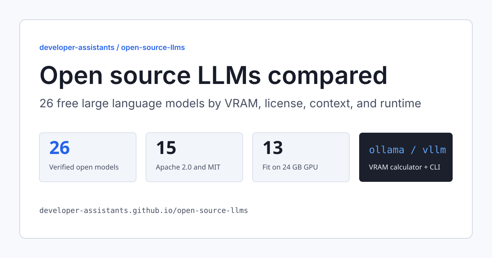

<div align="center">

# Open Source LLMs: Directory, VRAM Calculator & Comparison (2026)

Compare 26 open source LLMs and free large language models by parameter count, 4-bit and FP16 VRAM requirements, context window, commercial license, and inference runtime.

[](#frontier-and-multi-gpu-open-source-llms)
[](#open-source-llm-licenses-explained)
[](#local-and-single-gpu-open-source-llms)
[](LICENSE)

[Interactive Web Directory & VRAM Calculator](https://developer-assistants.github.io/open-source-llms/) · [Best Open Source LLM by Task](#quick-decision-matrix-by-workload) · [Local Models by VRAM](#vram-and-hardware-sizing-guide) · [License Comparison](#open-source-llm-licenses-explained) · [Python CLI](#interactive-python-cli)

<br>



</div>

## Why this directory exists

Teams picking an open source LLM usually run into stale leaderboards or marketing posts that skip memory math and license restrictions. A 671B Mixture-of-Experts model and a 24B dense model solve different engineering problems:

- Developers running a local assistant on a laptop or RTX 4090 need 4B to 32B models that fit inside 8 GB to 24 GB of VRAM with spare room for KV cache.
- Product teams shipping commercial features need clear answers on Apache 2.0 and MIT models versus community licenses that carry monthly active user limits or distillation clauses.
- Infrastructure teams deploying self-hosted endpoints on vLLM or SGLang need active parameter counts, native context lengths, and quantization headroom before renting H100 or L40S nodes.

This repository maintains a verified JSON catalog ([`models.json`](models.json)), an interactive GitHub Pages directory with a hardware VRAM calculator ([`developer-assistants.github.io/open-source-llms`](https://developer-assistants.github.io/open-source-llms/)), and a zero-dependency Python CLI ([`llm_advisor.py`](llm_advisor.py)).

## Quick decision matrix by workload

| Workload / hardware context | Best open source LLM picks | Why they fit | Quick links |
| :--- | :--- | :--- | :--- |
| Frontier reasoning and math (multi-GPU) | DeepSeek-R1, DeepSeek-V3.1, GLM-4.5 | MIT license, strong chain-of-thought reasoning, MoE throughput | [DeepSeek-R1](https://huggingface.co/deepseek-ai/DeepSeek-R1) · [GLM-4.5](https://huggingface.co/zai-org/GLM-4.5) |
| General purpose flagship (permissive OSS) | Qwen3-235B-A22B, DeepSeek-V3.1 | Apache 2.0 / MIT terms, toggleable thinking mode, broad language coverage | [Qwen3-235B](https://huggingface.co/Qwen/Qwen3-235B-A22B) · [DeepSeek-V3.1](https://huggingface.co/deepseek-ai/DeepSeek-V3.1) |
| Single 24 GB GPU all-rounder | Qwen3-32B, Gemma 3 27B | Fits inside 24 GB at 4-bit quantization with 128K context | [Qwen3-32B](https://huggingface.co/Qwen/Qwen3-32B) · [Gemma 3 27B](https://huggingface.co/google/gemma-3-27b-it) |
| Local coding and IDE agents | Devstral Small (24B), Qwen2.5-Coder-32B, Qwen3-Coder-480B | Fast local fill-in-the-middle completion or repository-scale edits under Apache 2.0 | [Devstral](https://huggingface.co/mistralai/Devstral-Small-2505) · [Qwen3-Coder](https://huggingface.co/Qwen/Qwen3-Coder-480B-A35B-Instruct) |
| 16 GB laptop or consumer GPU | gpt-oss-20b, Mistral Small 3.1 (24B), Phi-4 (14B), Gemma 3 12B | Runs on 12 GB to 16 GB VRAM or 24 GB Apple Silicon unified memory | [gpt-oss-20b](https://huggingface.co/openai/gpt-oss-20b) · [Mistral Small 3.1](https://huggingface.co/mistralai/Mistral-Small-3.1-24B-Instruct-2503) |
| 8 GB laptop and edge devices | Qwen3-8B, Llama 3.1 8B, Gemma 3 4B | Requires 3.5 GB to 5.5 GB at Q4_K_M quantization | [Qwen3-8B](https://huggingface.co/Qwen/Qwen3-8B) · [Gemma 3 4B](https://huggingface.co/google/gemma-3-4b-it) |
| Ultra-long-context RAG | Llama 4 Scout (10M), Llama 4 Maverick (1M), Command A (256K) | Processes entire codebases and large document sets in one prompt | [Llama 4 Scout](https://huggingface.co/meta-llama/Llama-4-Scout-17B-16E-Instruct) · [Llama 4 Maverick](https://huggingface.co/meta-llama/Llama-4-Maverick-17B-128E-Instruct) |
| Truly open data and reproducible research | OLMo 2 32B | Publishes weights, pretraining corpora, checkpoints, and training code under Apache 2.0 | [OLMo 2 32B](https://huggingface.co/allenai/OLMo-2-0325-32B-Instruct) |

## Local and single-GPU open source LLMs

These free large language models run on a single desktop GPU, workstation card, or Apple Silicon Mac at 4-bit quantization (GGUF Q4_K_M, AWQ, or MXFP4).

| Model | Organization | Params | Context | VRAM (Q4) | VRAM (FP16) | License | Ollama command |
| :--- | :--- | :--- | :---: | :---: | :---: | :--- | :--- |
| [Gemma 3 4B](https://huggingface.co/google/gemma-3-4b-it) | Google | 4.3B Dense | 128K | 3.5 GB | 9 GB | Gemma License | `ollama run gemma3:4b` |
| [Llama 3.1 8B](https://huggingface.co/meta-llama/Llama-3.1-8B-Instruct) | Meta | 8B Dense | 128K | 5.2 GB | 16.5 GB | Llama 3.1 Community | `ollama run llama3.1:8b` |
| [Qwen3-8B](https://huggingface.co/Qwen/Qwen3-8B) | Alibaba Qwen | 8.2B Dense | 128K | 5.5 GB | 17 GB | Apache-2.0 | `ollama run qwen3:8b` |
| [Gemma 3 12B](https://huggingface.co/google/gemma-3-12b-it) | Google | 12.2B Dense | 128K | 8.5 GB | 25 GB | Gemma License | `ollama run gemma3:12b` |
| [Phi-4 (14B)](https://huggingface.co/microsoft/phi-4) | Microsoft | 14.7B Dense | 16K | 9.5 GB | 30 GB | MIT | `ollama run phi4:14b` |
| [gpt-oss-20b](https://huggingface.co/openai/gpt-oss-20b) | OpenAI | 21B MoE (3.6B active) | 128K | 13 GB | 42 GB | Apache-2.0 | `ollama run gpt-oss:20b` |
| [Mistral Small 3.1 (24B)](https://huggingface.co/mistralai/Mistral-Small-3.1-24B-Instruct-2503) | Mistral AI | 24B Dense | 128K | 15 GB | 48 GB | Apache-2.0 | `ollama run mistral-small3.1:24b` |
| [Devstral Small (24B)](https://huggingface.co/mistralai/Devstral-Small-2505) | Mistral AI | 24B Dense | 128K | 15 GB | 48 GB | Apache-2.0 | `ollama run devstral:24b` |
| [Gemma 3 27B](https://huggingface.co/google/gemma-3-27b-it) | Google | 27.4B Dense | 128K | 17 GB | 55 GB | Gemma License | `ollama run gemma3:27b` |
| [Qwen3-32B](https://huggingface.co/Qwen/Qwen3-32B) | Alibaba Qwen | 32.8B Dense | 128K | 20 GB | 66 GB | Apache-2.0 | `ollama run qwen3:32b` |
| [DeepSeek-R1-Distill-Qwen-32B](https://huggingface.co/deepseek-ai/DeepSeek-R1-Distill-Qwen-32B) | DeepSeek | 32.8B Dense | 128K | 20 GB | 66 GB | MIT | `ollama run deepseek-r1:32b` |
| [Qwen2.5-Coder-32B](https://huggingface.co/Qwen/Qwen2.5-Coder-32B-Instruct) | Alibaba Qwen | 32.5B Dense | 128K | 20 GB | 65 GB | Apache-2.0 | `ollama run qwen2.5-coder:32b` |
| [OLMo 2 32B](https://huggingface.co/allenai/OLMo-2-0325-32B-Instruct) | AllenAI | 32.2B Dense | 4K | 20 GB | 65 GB | Apache-2.0 | `ollama run olmo2:32b` |
| [Llama 3.3 70B](https://huggingface.co/meta-llama/Llama-3.3-70B-Instruct) | Meta | 70.6B Dense | 128K | 42 GB | 142 GB | Llama 3.3 Community | `ollama run llama3.3:70b` |

## Frontier and multi-GPU open source LLMs

Larger Mixture-of-Experts (MoE) and dense models built for single-80 GB H100 nodes or multi-GPU clusters running vLLM or SGLang.

| Model | Organization | Params | Context | VRAM (Q4) | VRAM (FP16) | License | Primary strength |
| :--- | :--- | :--- | :---: | :---: | :---: | :--- | :--- |
| [GLM-4.5-Air](https://huggingface.co/zai-org/GLM-4.5-Air) | Zhipu AI | 106B MoE (12B active) | 128K | 62 GB | 212 GB | MIT | Agentic tool use on 80 GB GPU |
| [Llama 4 Scout](https://huggingface.co/meta-llama/Llama-4-Scout-17B-16E-Instruct) | Meta | 109B MoE (17B active) | 10M | 65 GB | 218 GB | Llama 4 Community | Ultra-long-context RAG and vision |
| [gpt-oss-120b](https://huggingface.co/openai/gpt-oss-120b) | OpenAI | 117B MoE (5.1B active) | 128K | 65 GB | 234 GB | Apache-2.0 | Single-H100 reasoning and tools |
| [Command A (111B)](https://huggingface.co/CohereForAI/c4ai-command-a-03-2025) | Cohere | 111B Dense | 256K | 66 GB | 222 GB | CC-BY-NC-4.0 | Enterprise RAG and citations (NC) |
| [Mistral Large 2 (123B)](https://huggingface.co/mistralai/Mistral-Large-Instruct-2411) | Mistral AI | 123B Dense | 128K | 72 GB | 246 GB | Mistral Research (MRL) | European multilingual dense model |
| [Qwen3-235B-A22B](https://huggingface.co/Qwen/Qwen3-235B-A22B) | Alibaba Qwen | 235B MoE (22B active) | 128K | 135 GB | 470 GB | Apache-2.0 | Flagship general and multilingual |
| [GLM-4.5](https://huggingface.co/zai-org/GLM-4.5) | Zhipu AI | 355B MoE (32B active) | 128K | 200 GB | 710 GB | MIT | Hybrid reasoning and agent loops |
| [Llama 4 Maverick](https://huggingface.co/meta-llama/Llama-4-Maverick-17B-128E-Instruct) | Meta | 400B MoE (17B active) | 1M | 230 GB | 800 GB | Llama 4 Community | Multimodal 128-expert flagship |
| [Qwen3-Coder-480B-A35B](https://huggingface.co/Qwen/Qwen3-Coder-480B-A35B-Instruct) | Alibaba Qwen | 480B MoE (35B active) | 256K | 270 GB | 960 GB | Apache-2.0 | Repository-scale software agents |
| [DeepSeek-R1](https://huggingface.co/deepseek-ai/DeepSeek-R1) | DeepSeek | 671B MoE (37B active) | 128K | 380 GB | 1350 GB | MIT | Frontier math and code reasoning |
| [DeepSeek-V3.1](https://huggingface.co/deepseek-ai/DeepSeek-V3.1) | DeepSeek | 671B MoE (37B active) | 128K | 380 GB | 1350 GB | MIT | Hybrid thinking and general chat |
| [Kimi K2](https://huggingface.co/moonshotai/Kimi-K2-Instruct) | Moonshot AI | 1T MoE (32B active) | 128K | 560 GB | 2000 GB | Modified MIT | Autonomous tool use and coding |

## VRAM and hardware sizing guide

Weight memory is easy to estimate before you download a 40 GB checkpoint:

| Precision | Approximate weight memory | Typical format |
| :--- | :--- | :--- |
| FP16 / BF16 | ~2 GB per billion parameters | Native PyTorch / safetensors |
| FP8 / Q8_0 | ~1 GB per billion parameters | vLLM FP8, GGUF Q8_0 |
| 4-bit | ~0.55 GB to 0.65 GB per billion parameters | GGUF Q4_K_M, AWQ, MXFP4 |

Always leave 2 GB to 8 GB of free VRAM for the KV cache if you send long documents or run concurrent requests. See the full [Local LLMs by VRAM guide](https://developer-assistants.github.io/open-source-llms/local-llms-by-vram.html) for GPU and Apple Silicon presets.

## Open source LLM licenses explained

Not every downloadable model has the same legal permissions. This catalog splits models into three tiers:

| License tier | Examples | Commercial terms |
| :--- | :--- | :--- |
| Permissive OSS | Apache 2.0, MIT (DeepSeek, Qwen3, Mistral Small 3.1, Devstral, GLM-4.5, gpt-oss, Phi-4, OLMo 2) | Free commercial hosting, fine-tuning, distillation, and redistribution with copyright notice |
| Community Commercial | Llama Community, Gemma License, Modified MIT (Kimi K2) | Free for most commercial products, with conditions such as Meta's 700M MAU threshold or distillation limits |
| Research / Non-Commercial | Mistral Research License (MRL), CC-BY-NC-4.0 (Command A) | Free for evaluation and academic testing; production commercial use requires a vendor license |

Read the full breakdown in [Open Source LLM Licenses Explained](https://developer-assistants.github.io/open-source-llms/open-source-llm-licenses.html).

## Self-hosted inference runtimes

Choose a runtime based on whether you are running on a personal workstation or serving concurrent API traffic:

- Ollama and LM Studio give the fastest setup on macOS, Linux, and Windows desktops, with one-line GGUF downloads and a local OpenAI-compatible API.
- llama.cpp exposes direct control over CPU and GPU layer splitting, quantized KV cache, and low-RAM laptops.
- vLLM handles production GPU serving with PagedAttention, continuous batching, and tensor parallelism across multi-GPU clusters.
- SGLang adds RadixAttention prefix caching for multi-turn agent loops, structured JSON outputs, and large MoE serving.

```bash
# Quick local chat with Ollama
ollama run qwen3:32b

# Production OpenAI-compatible server with vLLM
vllm serve Qwen/Qwen3-32B --tensor-parallel-size 1 --max-model-len 32768
```

## Interactive Python CLI

`llm_advisor.py` requires only Python 3.9+ from the standard library:

```bash
# List all Apache 2.0 and MIT models that fit on a 24 GB GPU at 4-bit quantization
python3 llm_advisor.py --vram 24 --license permissive-oss

# Recommend the best coding models for a 16 GB GPU
python3 llm_advisor.py --recommend --vram 16 --task coding --permissive-only

# Compare up to 3 models side by side
python3 llm_advisor.py --compare qwen3-32b gemma-3-27b devstral-small

# Filter models that release open training data
python3 llm_advisor.py --open-data

# Validate models.json schema and docs sync
python3 llm_advisor.py --validate
```

## Dedicated web guides

- [Interactive Open Source LLMs Directory](https://developer-assistants.github.io/open-source-llms/)
- [Best Open Source LLM by Workload](https://developer-assistants.github.io/open-source-llms/best-open-source-llm.html)
- [Free Large Language Models for Commercial Use](https://developer-assistants.github.io/open-source-llms/free-large-language-models.html)
- [Local LLMs by VRAM (8 GB to 80 GB)](https://developer-assistants.github.io/open-source-llms/local-llms-by-vram.html)
- [Open Source Coding LLMs](https://developer-assistants.github.io/open-source-llms/open-source-coding-llms.html)
- [Open Source Reasoning LLMs](https://developer-assistants.github.io/open-source-llms/open-source-reasoning-llms.html)
- [Open Source LLM Licenses Explained](https://developer-assistants.github.io/open-source-llms/open-source-llm-licenses.html)
- [Self-Hosted LLM Inference Engines](https://developer-assistants.github.io/open-source-llms/self-hosted-llm-inference.html)

## Contributing

To add a model or update parameter counts, VRAM estimates, or licenses:

1. Edit [`models.json`](models.json).
2. Rebuild the static pages and sync `docs/models.json` with `python3 build_site.py`.
3. Run `python3 llm_advisor.py --validate` and `python3 -m unittest discover -s tests -v`.
4. Open a pull request. See [`CONTRIBUTING.md`](CONTRIBUTING.md) for field definitions.

## License

MIT License. See [`LICENSE`](LICENSE) for details.
